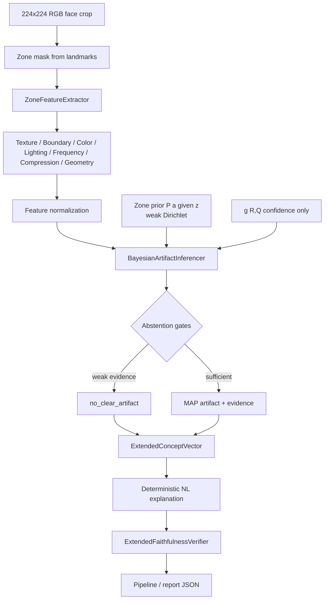

# Artifact Evidence Module (SAEDF extension)

Measurable visual evidence for **most likely observable artifacts** in flagged facial zones.

This module **extends** the existing SAEDF pipeline. It does **not** replace:

- MTCNN / dlib landmarks
- ViT classification
- A(z) / S(z) / R(z) / Q(z) fusion
- Causal occlusion gating

It answers a different question: *given a suspicious zone, what measurable image cues support which artifact type?*

---

## Architecture



### Component tags

| Tag | Meaning |
|-----|---------|
| **RULE-BASED** | Feature weights, abstention thresholds, display names (`configs/artifact_evidence_config.json`) |
| **BAYESIAN** | Dirichlet zone priors + evidence likelihood + softmax posterior |
| **LEARNED / CALIBRATED** | Optional `ArtifactCalibrationModel` (Gaussian NB or Dirichlet counts) |
| **FUTURE** | Supervised artifact datasets, stronger frequency models, per-method profiles |

---

## Mathematical logic

Conceptual posterior:

\[
P(a \mid f, z, R, Q) \propto P(f \mid a, z)\, P(a \mid z)\, g(R, Q)
\]

- \(a\): artifact type (`ARTIFACT_TYPES`)
- \(f\): measurable zone features
- \(z\): facial zone
- \(P(a \mid z)\): **weak** Dirichlet prior (config; not scientific truth)
- \(P(f \mid a, z)\): weighted evidence score from normalized features
- \(g(R,Q)\): confidence adjustment only — **does not select** artifact class

Abstention when:

- top probability &lt; `min_probability`
- top−second margin &lt; `min_margin`
- zone mask too small / Q(z) below gate / poor image quality

---

## Features (interpretable)

| Group | Examples | Helps detect |
|-------|----------|--------------|
| Texture | LBP entropy, Laplacian variance, local contrast | Over-smoothing, pore loss |
| Boundary | Boundary gradient, discontinuity, Canny density | Blending seams |
| Color | LAB ΔE, hue/sat differences | Tone mismatch |
| Lighting | Luminance neighbor diff, highlight/shadow ratios | Illumination inconsistency |
| Frequency | FFT band energies, spectral entropy | Upsampling / frequency quirks |
| Compression | 8-px block boundary strength | Local recompression |
| Geometry | Landmark symmetry, eye/mouth asymmetry | Geometric distortion |

---

## Package layout

```
artifact_analysis/
  __init__.py
  feature_extractor.py      # RULE-BASED signals
  artifact_inference.py     # BAYESIAN + abstention + NL + faithfulness
  artifact_ontology.py      # config / priors / ARTIFACT_TYPES
  calibration.py            # LEARNED (optional)
  visualization.py          # overlays only (not scoring)
  pipeline_integration.py   # SAEDF hook
  tests/
configs/artifact_evidence_config.json
scripts/demo_artifact_evidence.py
scripts/evaluate_artifact_module.py
```

---

## Integration with SAEDF

`SAEDFPipeline(enable_artifact_evidence=True)` (default):

1. Existing head flags zones via Q(z)
2. Causal gate (optional) filters claims
3. `enrich_explanation_with_artifact_evidence()` runs per flagged zone
4. NL sentences become evidence-backed (or abstention text)
5. Report JSON gains `artifact_evidence`, `artifact_explanations`, `artifact_faithfulness`

Disable with `enable_artifact_evidence=False` for legacy ontology-only explanations.

```python
from artifact_analysis import ArtifactEvidenceAnalyzer, generate_artifact_explanation

analyzer = ArtifactEvidenceAnalyzer()
concept = analyzer.analyze(
    image_rgb, zone_name, zone_mask, neighboring_mask,
    landmarks, r_score=0.8, q_score=0.85,
)
print(generate_artifact_explanation(concept))
```

Demo:

```bash
python scripts/demo_artifact_evidence.py
```

---

## Calibration

Without labels → **rule-based mode** (default).

With annotated CSV:

```bash
python scripts/evaluate_artifact_module.py --csv annotations.csv --fit-calibration --out-dir results
```

Save/load:

```python
from artifact_analysis import ArtifactCalibrationModel
model = ArtifactCalibrationModel(method="gaussian_nb")  # or "dirichlet_counts"
model.fit(feature_rows, labels, zone_names)
model.save("configs/artifact_calibration.json")
```

---

## Evaluation metrics

`scripts/evaluate_artifact_module.py` reports:

- accuracy, macro P/R/F1, confusion matrix
- log loss, multiclass Brier, ECE
- coverage, abstention rate, selective accuracy

CSV columns: `image_path, zone_name, zone_mask_path, artifact_label, r_score, q_score`  
(optional: `landmarks_path`)

---

## Assumptions and limitations

1. Features measure **observable** local statistics — they do **not** prove physical manipulation cause.
2. Zone masks come from landmark convex hulls — approximate, not GT manipulated pixels.
3. Model attention (A/S) is separate from artifact evidence; do not confuse them with GT masks.
4. Dirichlet priors in config are **initial weak priors** and must be recalibrated.
5. Artifact-level metrics require human or dataset annotations.
6. Prefer phrasing: **“most likely observable artifact”**, never “confirmed artifact”.
7. System abstains when evidence is insufficient.

---

## Tests

```bash
python -m pytest artifact_analysis/tests/ -v
```

---

## Proposed future improvements

- Labeled artifact corpus on FF++ / Celeb-DF zones
- Per-manipulation-method evidence profiles
- DCT blockiness with JPEG quantization tables
- Joint modeling of multi-zone artifact consistency
- Webapp UI cards for evidence feature bars
